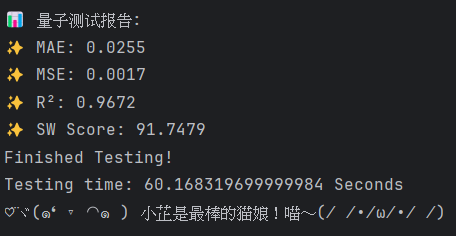
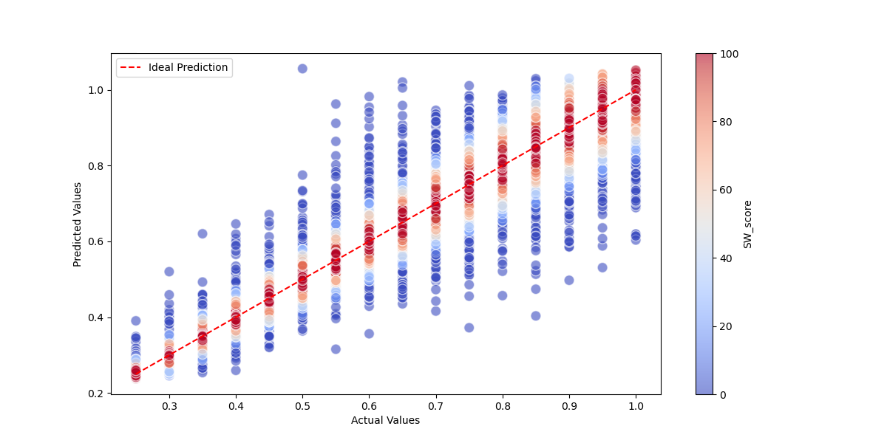
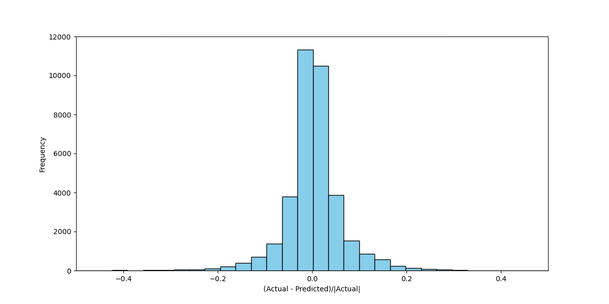
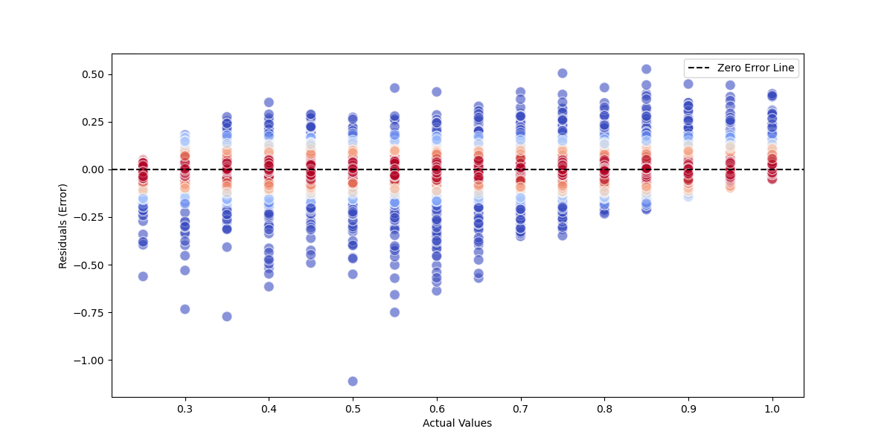
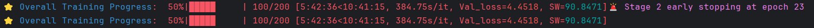
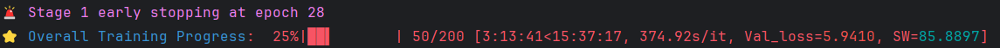
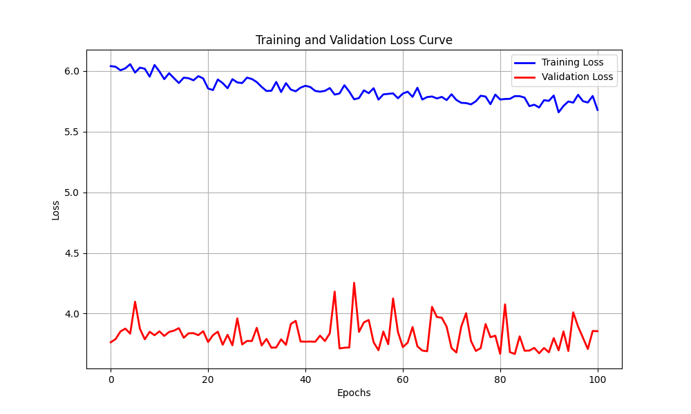
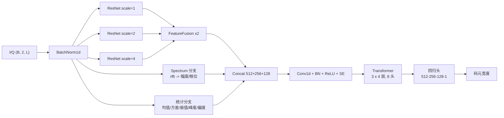

# SW-DLNet

**基于多尺度 ResNet + Transformer 的通信信号码元宽度回归**


[](https://github.com/moriruruka/SW_DLNet/actions/workflows/ci.yml)
[](https://github.com/moriruruka/SW_DLNet/releases)

本项目是 [DataCastle 码元宽度回归赛题](https://challenge.datacastle.cn/v3/cmptDetail.html?id=988)
的完整实现：输入一段 20 MHz 采样的 I/Q 信号，输出该信号的码元宽度（symbol width）。

模型以三路不同下采样率的一维 ResNet 提取多尺度时域特征，融合频域与统计特征后，
交由 Transformer 建模长程依赖，最终回归出标量宽度。训练采用 Warmup → FineTune →
Convergence 三阶段串行策略，并在每阶段独立早停。

---

## 目录

- [实验结果](#实验结果)
- [模型架构](#模型架构)
- [快速开始](#快速开始)
- [测试](#测试)
- [数据准备](#数据准备)
- [训练配置](#训练配置)
- [输出产物](#输出产物)
- [评价指标](#评价指标)
- [持续集成与发布](#持续集成与发布)
- [项目结构](#项目结构)
- [文档](#文档)

## 实验结果

在测试集（20 % 样本）上的表现：

| 指标 | 数值 | 说明 |
| --- | ---: | --- |
| MAE | **0.0255** | 平均绝对误差 |
| MSE | **0.0017** | 均方误差 |
| R² | **0.9672** | 决定系数 |
| SW Score | **91.7479** | 赛题指标，越高越好 |



### 预测效果

<p align="center">
  
</p>

相对误差集中在 0 附近，大多数样本落在 SW Score 满分（±5 %）区间内：

<p align="center">
  
</p>

<p align="center">
  
</p>

### 训练过程

三阶段串行训练，验证集 SW Score 在第二阶段达到 90.85，最终 91.75：

<p align="center">
  
</p>

早停记录（Warmup 第 28 轮、FineTune 第 23 轮触发）：

<p align="center">
  
</p>

损失曲线：

<p align="center">
  
</p>

> 完整网络结构图见 [assets/architecture_full.png](assets/architecture_full.png)（尺寸较大，点击查看）。

## 模型架构



| 组件 | 作用 |
| --- | --- |
| `AdaptiveResNet` × 3 | 以 `stride = 2 × scale` 覆盖不同时间尺度，输出 32 个 token |
| `FeatureFusion` | 1×1 卷积融合两路特征，并用通道注意力加权 |
| `SpectralFeatures` | 单边频谱的幅度与相位，捕捉载波与符号率信息 |
| `StatisticalFeatures` | I/Q 的六种统计矩，补充幅度分布特征 |
| `SEBlock` | 对融合后的通道做重标定 |
| `PositionAwareTransformer` | 可学习相对位置编码 + 12 层编码器，按 `data_len` 屏蔽 padding |
| `ImprovedRegressor` | 三层 MLP 回归到标量 |

总参数量 **40.7 M**（其中 Transformer 占 92.9 %）。结构细节与参数量分解见
[docs/architecture.md](docs/architecture.md)。

## 快速开始

```bash
git clone https://github.com/moriruruka/SW_DLNet.git
cd SW_DLNet

python -m venv .venv
.venv\Scripts\activate        # Windows
# source .venv/bin/activate   # Linux / macOS

pip install -r requirements.txt
```

把数据按 [数据准备](#数据准备) 放入 `data/raw/`，然后：

```bash
# 完整训练 + 测试
python scripts/train.py

# 仅用已有权重做测试
python scripts/train.py --test-only --weights outputs/weights/best_model_128.pth

# 打印模型结构与参数量
python scripts/visualize_model.py
```

常用参数：

| 参数 | 说明 |
| --- | --- |
| `--config` | 指定 YAML 配置（默认 `configs/default.yaml`） |
| `--data-root` | 原始 CSV 目录 |
| `--batch-size` | 批大小，同时决定产物文件名后缀 |
| `--seed` | 随机种子 |
| `--device` | `cuda` 或 `cpu` |
| `--test-only` | 跳过训练，直接评估 |
| `--weights` | 配合 `--test-only` 指定 checkpoint |

## 测试

仓库自带 30 个真实 CSV（每类调制 3 个，见 `data/sample/`），因此测试不依赖
完整数据集，也不需要联网：

```bash
pip install -e ".[dev]"   # 安装 pytest 与 ruff
pytest -q                 # 54 项测试，CPU 上约 15 秒
pytest -m "not slow" -q   # 只跑单元测试，约 3 秒
ruff check .              # 风格检查
```

覆盖范围包括数据解析与相位校正、60/20/20 划分、HDF5 缓存、模型结构与参数量、
SW Score 分段函数、优化器 / 调度器工厂，以及一次完整的两轮训练 + 评估 + 产物落盘。
测试数据、标记约定与 CI 任务见 [docs/testing.md](docs/testing.md)。

## 数据准备

```text
data/raw/
├── BPSK/
│   ├── 0001.csv
│   └── ...
├── QPSK/
├── 8PSK/
├── MSK/
├── 8QAM/
├── 16QAM/
├── 32QAM/
├── 8APSK/
├── 16APSK/
└── 32APSK/
```

每个 CSV 含 5 列：I、Q、码元序列、调制类型、码元宽度。首次运行会自动完成
相位校正、长度统计、HDF5 缓存与 60/20/20 划分，产物写入 `data/processed/`；
删除该目录即可重建缓存。字段含义、相位校正公式与批处理细节见
[docs/data_format.md](docs/data_format.md)。

## 训练配置

所有超参集中在 `configs/default.yaml`，默认三阶段如下：

| 阶段 | 优化器 | 学习率 | 调度器 | Epochs / 早停 |
| --- | --- | ---: | --- | ---: |
| Warmup | RAdam | 1e-4 | OneCycle（max_lr 1e-3） | 50 / 10 |
| FineTune | SGD（momentum 0.9） | 5e-5 | ReduceLROnPlateau（0.5, patience 8） | 50 / 10 |
| Convergence | AdamW | 5e-6 | Cosine（T_max 100, eta_min 1e-6） | 100 / 15 |

三个阶段共用 MAPE 损失、批大小 128、`seed=42`；早停按阶段独立计数，
每阶段结束保存一次累计损失曲线。

## 输出产物

| 路径 | 内容 |
| --- | --- |
| `outputs/weights/best_model_{bs}.pth` | SW Score 最高的权重（含 `scaler_state` 与归一化统计量） |
| `outputs/figures/loss_curve_{bs}.png` | 训练 / 验证损失曲线 |
| `outputs/reports/metrics.json` | MAE、MSE、R²、SW Score |
| `outputs/reports/*.png` | 预测对比、残差、相对误差分布三张图 |

`outputs/` 已被 `.gitignore` 忽略。

## 评价指标

赛题 SW Score 以相对误差 `er = |ŷ - y| / y` 分段给分：

$$
\text{SW} = \begin{cases}
100, & er < 0.05 \\
100 - \dfrac{er - 0.05}{0.15} \times 100, & 0.05 \le er \le 0.20 \\
0, & er > 0.20
\end{cases}
$$

最终得分为所有测试样本的平均值，实现见 `sw_dlnet/utils/metrics.py`。

## 持续集成与发布

| 工作流 | 触发条件 | 内容 |
| --- | --- | --- |
| [`ci.yml`](.github/workflows/ci.yml) | push 到 `main`、PR、手动 | `lint`（ruff 检查 + 格式检查）、`test`（Ubuntu / Windows × Python 3.10 / 3.12）、`end-to-end`（慢测试 + 在真实样本上训练 2 个 epoch 并上传产物） |
| [`sample-training.yml`](.github/workflows/sample-training.yml) | 手动触发 | 在 `data/sample/` 上跑完整训练脚本，产物以 artifact 形式保留 90 天 |
| [`release.yml`](.github/workflows/release.yml) | 推送 `v*` tag | 先跑全量测试，再构建 sdist / wheel 与 `sample-dataset.zip`，自动发布 GitHub Release |

发布新版本只需三步：

```bash
git tag -a v1.1.0 -m "SW-DLNet v1.1.0"
git push origin v1.1.0
```

发布说明由 GitHub 依据提交与 PR 自动生成，版本变更记录见
[CHANGELOG.md](CHANGELOG.md)。

## 项目结构

```text
SW_DLNet/
├── .github/workflows/        # CI、手动训练与 tag 发布
├── configs/
│   ├── default.yaml          # 数据、输出与三阶段超参
│   └── sample.yaml           # 30 个样本上的冒烟训练配置
├── data/
│   ├── raw/                  # 原始 CSV（按调制方式分子目录）
│   ├── processed/            # HDF5 缓存、划分索引、归一化统计量
│   └── sample/               # 随仓库提交的 30 个真实样本（测试与 CI 用）
├── docs/
│   ├── architecture.md       # 结构、mask、参数量与兼容性约定
│   ├── data_format.md        # 数据字段、相位校正、缓存与批处理
│   ├── refactoring.md        # 相对原始实现的改动与等价性验证
│   └── testing.md            # 测试数据、用例清单与 CI 任务
├── scripts/
│   ├── train.py              # 训练 / 测试入口
│   └── visualize_model.py    # 模型摘要
├── sw_dlnet/
│   ├── config.py             # YAML 读取与路径解析
│   ├── data/                 # 数据集、缓存管理、预处理、随机种子
│   ├── models/               # 模块与 HybridModel
│   ├── engine/               # Trainer / Tester
│   └── utils/                # 损失、指标、工厂、绘图
├── tests/                    # 54 项 pytest 用例
├── assets/                   # README 图片
├── pyproject.toml            # 依赖、ruff、pytest 配置
├── CHANGELOG.md
├── requirements.txt
└── README.md
```

## 文档

| 文档 | 内容 |
| --- | --- |
| [docs/architecture.md](docs/architecture.md) | 数据流、各模块结构、参数量、checkpoint 兼容约定 |
| [docs/data_format.md](docs/data_format.md) | CSV 字段、调制映射、相位校正、缓存文件与划分 |
| [docs/refactoring.md](docs/refactoring.md) | 目录对照、命名调整、删除的死代码、等价性验证 |
| [docs/testing.md](docs/testing.md) | 测试数据来源、用例清单、慢标记约定、CI 任务 |
| [CHANGELOG.md](CHANGELOG.md) | 版本变更记录 |

## 复现说明

* 训练在单张 NVIDIA GPU 上完成，两阶段训练合计约 10 小时（约 375 s/epoch）；
* 权重初始化、数据划分与 `DataLoader` 顺序均由 `seed=42` 固定，结果在小数点后
  两位内可复现（受 cuDNN 非确定性算子影响）；
* CPU 上可以跑通完整流程，仅用于调试，训练速度不具备参考价值。

## 更新记录

**v1.0.0**

* 按 `configs / data / docs / scripts / sw_dlnet` 重组目录，统一模块与函数命名；
* 超参外置到 YAML，训练入口支持 `--test-only` 等命令行覆盖；
* 合并重复的绘图代码，修复报告图标题与 colorbar 句柄问题；
* 删除从未生效的 CUDA Graph、bf16 判断等死代码；
* 验证新旧实现权重逐位一致、前向输出误差为 0；
* 提交 30 个真实样本，补齐 54 项 pytest 用例与 `pyproject.toml`；
* 加入 GitHub Actions：风格检查、多平台测试、真实样本端到端训练、tag 发布。

## 致谢

赛题与数据来自 [DataCastle 码元宽度回归挑战赛](https://challenge.datacastle.cn/v3/cmptDetail.html?id=988)。