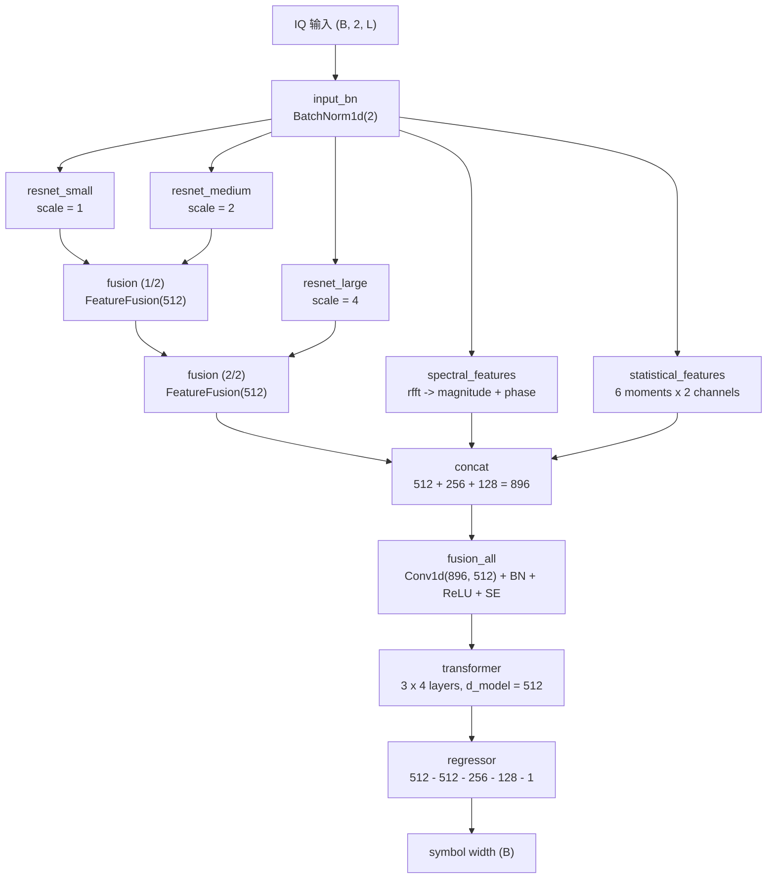

# 模型架构

本文描述 `sw_dlnet.models.HybridModel` 的结构、数据流和参数量。所有尺寸以
`batch_size = B`、输入 IQ 长度 `L`（20 MHz 采样）为例。

## 1. 总览



三个 ResNet 编码器共享同一份输入，但下采样率不同（`stride = 2 * scale`），
因此分别关注不同时间尺度上的码元边界；它们经两级 `FeatureFusion` 融合后，
与频域、统计特征拼接，再由 Transformer 在 32 个时间 token 上建模长程依赖，
最后回归出单个码元宽度。

## 2. 模块细节

| 模块 | 结构 | 输出 |
| --- | --- | --- |
| `input_bn` | `BatchNorm1d(2)` | (B, 2, L) |
| `AdaptiveResNet(scale)` | Conv1d(2, 64, k=7, s=2·scale) → BN → ReLU → MaxPool(3, s=2·scale) → 4 × `ResBlock` → `AdaptiveAvgPool1d(32)` | (B, 512, 32) |
| `FeatureFusion` | `Conv1d(1024, 512, 1)` + 通道注意力 `AvgPool → Conv → ReLU → Conv → Sigmoid` | (B, 512, 32) |
| `SpectralFeatures` | `rfft` → `|·|` 与 `angle` 拼接 → 3 层 Conv1d(7/5/3) → `AdaptiveAvgPool1d(32)` | (B, 256, 32) |
| `StatisticalFeatures` | mean / std / max / min / kurtosis / skewness（各 2 通道）→ repeat 到 32 → 2 层 1×1 Conv | (B, 128, 32) |
| `fusion_all` | `Conv1d(896, 512, 1)` → BN → ReLU → `SEBlock(512)` | (B, 512, 32) |
| `PositionAwareTransformer` | 可学习相对位置 `(32, 512)` + 3 × 4 层 `TransformerEncoderLayer`（8 头，FFN 2048，dropout 0.2） | (B, 512) |
| `ImprovedRegressor` | Linear 512 → 512 → 256 → 128 → 1，前三层 BN + ReLU + Dropout(0.3) | (B,) |

`ResBlock` 为瓶颈残差块：`1×1` 降维到 `out/4`、`3×3` 主卷积、`1×1` 升维，接
`SEBlock`，shortcut 为 `1×1` 卷积 + BN + Dropout(0.1)（`stride != 1` 或通道变化时），
激活统一使用 `F.gelu`。

## 3. Transformer 的 padding mask

`PositionAwareTransformer.forward` 依据 `data_len` 构造 mask：

```python
valid_len = min(int(length / (2e7 // 32)), 32)
pad_mask[i, valid_len:] = True
```

即每条样本按 20 MHz 采样率换算成 32 个 token 中真正有效的个数，其余位置在
`src_key_padding_mask` 中被屏蔽。注意 mask 传入前取反（`~pad_mask`），与该层
“True 表示忽略”的语义一致。

## 4. 参数量

| 模块 | 参数量 | 占比 |
| --- | ---: | ---: |
| `input_bn` | 4 | <0.1 % |
| `resnet_small` | 418,620 | 1.0 % |
| `resnet_medium` | 418,620 | 1.0 % |
| `resnet_large` | 418,620 | 1.0 % |
| `fusion` | 558,112 | 1.4 % |
| `spectral_features` | 142,400 | 0.3 % |
| `statistical_features` | 9,536 | <0.1 % |
| `fusion_all` | 493,600 | 1.2 % |
| `transformer` | 37,847,040 | 92.9 % |
| `regressor` | 428,801 | 1.1 % |
| **总计** | **40,735,353** | 100 % |

运行 `python scripts/visualize_model.py` 可以得到逐层摘要。

## 5. 兼容性约定

为了能够直接加载历史 checkpoint（`model_state_dict` 键名完全一致），以下约定
不要随意改动：

1. 子模块的创建顺序保持 `input_bn → resnet_small → resnet_medium → resnet_large →
   fusion → spectral_features → statistical_features → fusion_all → transformer →
   regressor`；顺序变化会改变初始化的随机数消耗，从而改变权重。
2. `AdaptiveResNet` 的 `scale` 依次为 1、2、4。
3. `PositionAwareTransformer` 中 `rel_pos_encoder`、`input_norm`、`transformers`、
   `final_norm` 的声明顺序保持不变（`input_norm` / `final_norm` 在 forward 中未使用，
   但必须保留以兼容 state dict）。
4. 训练脚本在建模前先取一个 batch（`next(iter(train_loader))`），复现原始实现中
   数据加载对随机数状态的消耗。